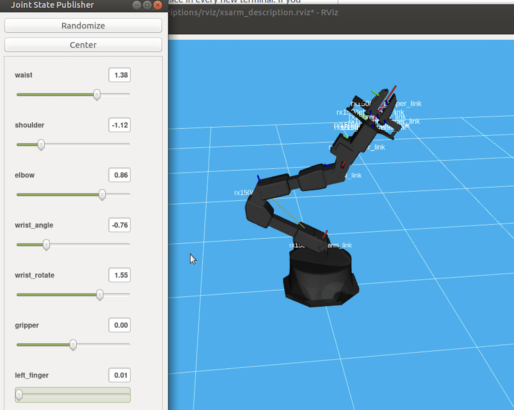
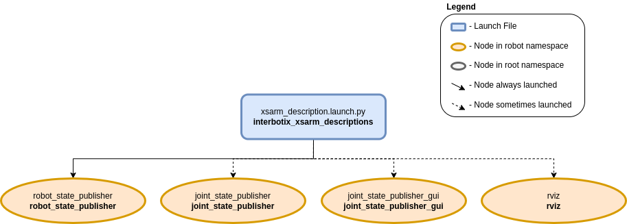
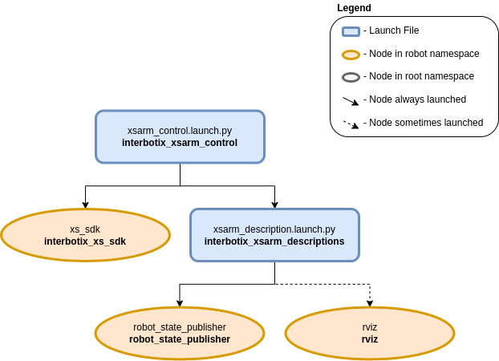
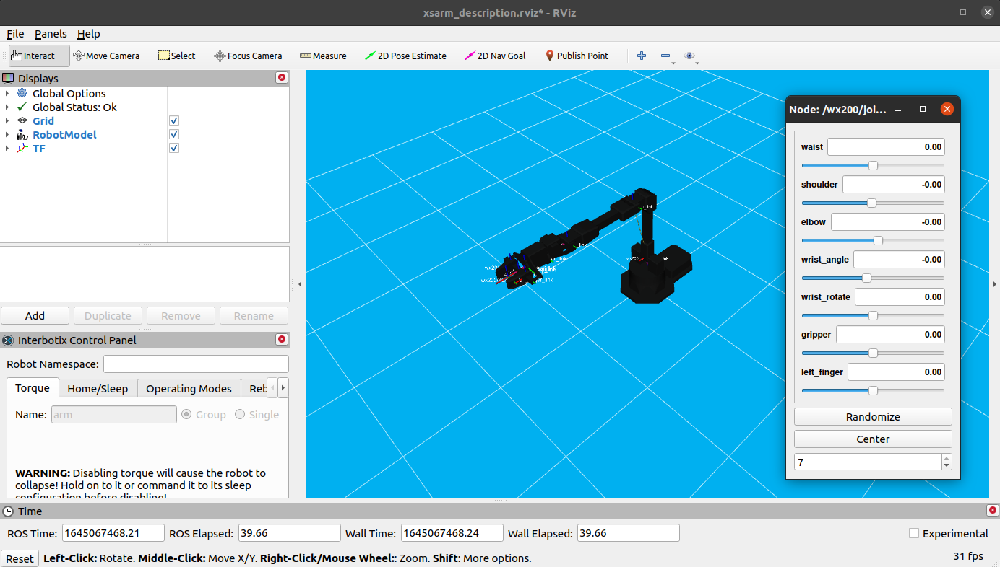

# ROS 2, RViz and the RX150

Getting started with the ReactorX 150 arm on the lab stations. Adapted from the Trossen Robotics
documentation and corrected against the software actually installed in Salazar 2008.

Work through it in order. Sections 1 to 3 are the virtual model, section 4 onward is the physical
arm.

---

## What you are working with

Four ROS 2 packages matter for this arm, and they build on each other:

| Package | What it gives you |
|---|---|
| `interbotix_xsarm_descriptions` | The URDF model of the arm: links, joints, limits, meshes. Everything else reads this |
| `interbotix_xs_sdk` | The driver. Talks to the DYNAMIXEL servos over the U2D2 and publishes joint states |
| `interbotix_xsarm_control` | Brings the two above together and launches the real arm with RViz |
| `interbotix_xs_modules` | The Python API, for writing your own motion code |

The split matters when something fails. A model that looks wrong in RViz is a `descriptions`
problem. An arm that does not respond is an `xs_sdk` problem, usually the USB connection. The two
are independent, and RViz happily shows you a perfect model of an arm that is not plugged in.

---

## 1. Before you start

The arms live in **Salazar 2008**. Four are available: **Arm-1 through Arm-4**.

Everything you need is already installed on the station. Log in with your SSU ID, open a
terminal, and connect the arm's USB cable to the machine.

Confirm the arm is detected. The U2D2 adapter should appear as `ttyDXL`:

```bash
ls /dev | grep ttyDXL
```

```
ttyDXL
```

If nothing prints, the arm is not connected or not powered. Check the USB cable and the power
adapter before going further. Every command below depends on this one line.

Confirm the packages are visible:

```bash
ros2 pkg list | grep interbotix
```

You should see seventeen packages, including `interbotix_xsarm_control`,
`interbotix_xsarm_descriptions`, `interbotix_xs_sdk` and `interbotix_xs_modules`.

> **You do not need to source anything.** The station does it at login, so a terminal you just
> opened already has ROS 2 Jazzy, the Interbotix workspace at `/opt/interbotix_ws` and the Python
> environment.
>
> The exception is a shell that is not an interactive login: a script you run, or a command sent
> over `ssh`. Ubuntu's `.bashrc` stops early for those, so nothing gets sourced and `ros2` is
> missing. Put these two lines at the top of such a script:
>
> ```bash
> source /opt/interbotix_ws/install/setup.bash
> source /opt/isl-venv/bin/activate
> ```
>
> Two lines, not three. A colcon workspace records the underlay it was built against, so sourcing
> the workspace brings in ROS 2 Jazzy with it and a separate `source /opt/ros/jazzy/setup.bash`
> adds nothing. The second line is the Python environment, which colcon knows nothing about.

---

## 2. The virtual model in RViz

Start here, with no hardware involved. Launch the model and the joint state publisher:

```bash
ros2 launch interbotix_xsarm_descriptions xsarm_description.launch.py \
  robot_model:=rx150 use_joint_pub_gui:=true
```

`robot_model:=rx150` is required. The package supports the whole X-Series, so it has to be told
which arm to draw.

RViz opens with the arm model and a slider panel. Move each slider and watch which part of the
arm responds. Identify all five joints and the gripper, and note each one's limits, which are the
ends of the slider range.



Set the arm to roughly the configuration above: `waist 1.38`, `shoulder -1.12`, `elbow 0.86`,
`wrist_angle -0.76`, `wrist_rotate 1.55`. Those are radians, and they are your reference numbers
for section 5.

Press **Ctrl + C** in the terminal to end the session.

What that one launch file started:



`robot_state_publisher` turns joint angles into link positions using the URDF.
`joint_state_publisher_gui` is the slider window, and it is there only because you passed
`use_joint_pub_gui:=true`. RViz draws the result. No hardware is involved anywhere in this
diagram.

**Video: arm descriptions and RViz** <https://youtu.be/c3oU_pygLZI>

More on arm descriptions:
<https://docs.trossenrobotics.com/interbotix_xsarms_docs/ros_interface/ros2/software_setup.html>

---

## 3. What RViz is showing you

RViz is a viewer, not the robot. It subscribes to `/rx150/joint_states` and draws the model at
whatever angles arrive on that topic. In section 2 those angles came from the slider GUI. In
section 4 they come from the encoders in the real servos.

This is the single most useful idea in the section. The same RViz window, unchanged, shows you a
simulated arm or a real one depending only on who is publishing joint states.

Worth seeing for yourself, with the description launch still running, in a second terminal:

```bash
ros2 topic list
ros2 topic echo /rx150/joint_states --once
```

---

## 4. The physical arm

**Keep a hand near the arm for this section.** The commands below turn the motors off, and an arm
with the motors off falls under its own weight.

Launch the driver and RViz together:

```bash
ros2 launch interbotix_xsarm_control xsarm_control.launch.py robot_model:=rx150
```

Every motor is torqued on by default, so the arm will resist you. Leave this terminal running and
open a second one for everything that follows.



Compare this with the diagram in section 2. `xsarm_control` calls the same
`xsarm_description.launch.py`, so `robot_state_publisher` and RViz are unchanged. The one
addition is `xs_sdk`, the driver that talks to the servos. It replaces the slider GUI as the
source of joint states, which is why the same RViz window now follows the real arm.

To see all available launch arguments:

```bash
ros2 launch interbotix_xsarm_control xsarm_control.launch.py --show-args
```

### Torque off

**Hold the arm or let it rest on the table before running this.** It will collapse.

```bash
ros2 service call /rx150/torque_enable interbotix_xs_msgs/srv/TorqueEnable \
  "{cmd_type: 'group', name: 'all', enable: false}"
```

Now move the arm and gripper by hand, and watch the RViz model follow. You are backdriving the
servos and their encoders are reporting the angles, which is why the model tracks you.

| Group | Servos |
|---|---|
| `all` | Every DYNAMIXEL servo on the robot |
| `arm` | The arm servos, with the gripper excluded |

Use `name: 'arm'` to leave the gripper torqued on while you move the arm.

### Torque on

Hold the arm in a pose you choose, then:

```bash
ros2 service call /rx150/torque_enable interbotix_xs_msgs/srv/TorqueEnable \
  "{cmd_type: 'group', name: 'all', enable: true}"
```

Let go. The arm holds position.

Repeat the torque off and on cycle a few times, choosing a different pose each time. This is the
quickest way to build intuition for the workspace and for which joints carry the load.

### The RViz control panel

In the RViz window, find the **Interbotix Control Panel**, docked at the lower left.



Type `rx150` into **Robot Namespace** and click **Update**, then select `all` under **Group
Name**. The panel's tabs are Torque, Home/Sleep, Operating Modes and Reboot. The Torque tab does
the same job as the service calls above, with the same warning.

On the **Home/Sleep** tab, click **Go to Home Pose**, then **Go to Sleep Pose**. Home is the arm
upright, sleep is the arm folded onto itself. Sleep is the pose the arm should always be left in.

> The screenshot shows a WidowX 200 in the namespace field, since it comes from the Trossen
> documentation. Yours reads `rx150`.

**Video: xsarm control** <https://youtu.be/vGCIU6CX72M>

Use the commands on this page rather than the ones spoken in the video. The video covers an
earlier release with different package names.

### Shutting down

**Send the arm to Sleep Pose first.** Ending the driver releases the motors, and an arm that is
not already folded will fall.

Then press **Ctrl + C** in the launch terminal.

---

## 5. Commanding the arm from Python

The RViz panel only reaches the two preset poses. To command joint angles, use the Python API in
`interbotix_xs_modules`.

Leave the control launch from section 4 running. The script connects to it.

Save this as `rx150_first_move.py`:

```python
#!/usr/bin/env python3
"""Move the RX150 to a set of joint angles, then fold it up."""

from interbotix_common_modules.common_robot.robot import robot_shutdown, robot_startup
from interbotix_xs_modules.xs_robot.arm import InterbotixManipulatorXS


def main():
    bot = InterbotixManipulatorXS(
        robot_model='rx150',
        group_name='arm',
        gripper_name='gripper',
    )
    robot_startup()

    # Five joints, in radians, base to wrist:
    # waist, shoulder, elbow, wrist_angle, wrist_rotate
    bot.arm.go_to_home_pose()
    bot.arm.set_joint_positions([0.0, -0.5, 0.6, 0.5, 0.0])
    bot.arm.set_single_joint_position('waist', 0.8)

    print('joint positions:', bot.arm.get_joint_positions())
    print('end effector pose:\n', bot.arm.get_ee_pose())

    bot.gripper.release()
    bot.gripper.grasp()

    bot.arm.go_to_sleep_pose()
    robot_shutdown()


if __name__ == '__main__':
    main()
```

Run it:

```bash
python3 rx150_first_move.py
```

Each call blocks until the motion finishes, so the arm completes one move before starting the
next.

### The calls you need

| Call | What it does |
|---|---|
| `bot.arm.go_to_home_pose()` | All joints to zero, arm upright |
| `bot.arm.go_to_sleep_pose()` | Folded. End every script with this |
| `bot.arm.set_joint_positions([w, s, e, wa, wr])` | Five joint angles in radians |
| `bot.arm.set_single_joint_position('waist', 0.8)` | One joint, by name |
| `bot.arm.set_ee_pose_components(x=0.3, z=0.2, pitch=0.5)` | Inverse kinematics to a Cartesian pose |
| `bot.arm.get_joint_positions()` | Current angles, as a list |
| `bot.arm.get_ee_pose()` | Current end effector pose, as a 4x4 matrix |
| `bot.arm.set_trajectory_time(moving_time=3.0)` | Seconds per motion. Raise it to slow the arm down |
| `bot.gripper.grasp()` / `bot.gripper.release()` | Close and open the gripper |

`set_ee_pose_components` returns a tuple: the joint solution, and a boolean saying whether the
inverse kinematics succeeded. **Check that boolean.** A pose outside the workspace returns
`False` and the arm does not move, which otherwise looks like the script hanging.

### Angles are in radians

The sliders in RViz are in radians too. `0.5` is roughly 29 degrees. To work in degrees:

```python
from math import radians
bot.arm.set_joint_positions([radians(0), radians(-30), radians(35), radians(30), radians(0)])
```

### Start slow

Begin with small angles near the home pose and work outward. A five-joint arm can reach into its
own base, and a large move commanded as a single step can take it through the table. Raise
`moving_time` while you are learning:

```python
bot.arm.set_trajectory_time(moving_time=4.0, accel_time=1.0)
```

---

## 6. Before you leave

1. Send the arm to **Sleep Pose**
2. Stop every launch with **Ctrl + C**
3. Disconnect the USB cable
4. Return all equipment to where you found it and tidy the station
5. **Log out. Leave the computer running.**

> **Log out, do not shut down.** Logging out ends your session and protects your files; the
> station itself stays on. The machines are maintained and updated remotely, and one that has
> been powered off cannot be reached, so it misses the work and is waiting broken for whoever
> sits down next. Leave it at the login screen.

---

## Troubleshooting

| Symptom | Cause |
|---|---|
| `ls /dev \| grep ttyDXL` prints nothing | Arm not connected or not powered. Everything else fails from here |
| RViz opens, arm does not move | You launched `xsarm_description`, which is the model only. Use `xsarm_control` for hardware |
| Arm falls when you run a command | Expected after a torque off. Support it by hand first |
| `set_ee_pose_components` appears to hang | The pose is outside the workspace. It returned `False`. Check the boolean |
| Service call rejected | The namespace is `/rx150`, so it must be `/rx150/torque_enable` |
| `ros2: command not found` | Your shell did not source ROS. Open a fresh terminal, or run the two `source` lines in section 1 |

---

## Notes on the lab build

Worth knowing, because they differ from the Trossen documentation online:

**MoveIt, Gazebo and the perception pipeline are not installed.** The stations carry the
description, driver, control and Python packages. Commands from the Trossen docs that reference
`interbotix_xsarm_moveit`, `interbotix_xsarm_sim`, `interbotix_xsarm_perception` or
`use_sim:=true` will not run here.

**The workspace is at `/opt/interbotix_ws`**, shared and read only. It is not in your home
directory, so older instructions that say `~/interbotix_ws` do not apply.

**Package names changed between ROS 1 and ROS 2.** Older guides refer to
`interbotix_descriptions`, `interbotix_sdk`, `interbotix_gazebo` and `interbotix_moveit`. The ROS
2 names all carry the `xs` or `xsarm` infix: `interbotix_xsarm_descriptions`,
`interbotix_xs_sdk`, and so on.
